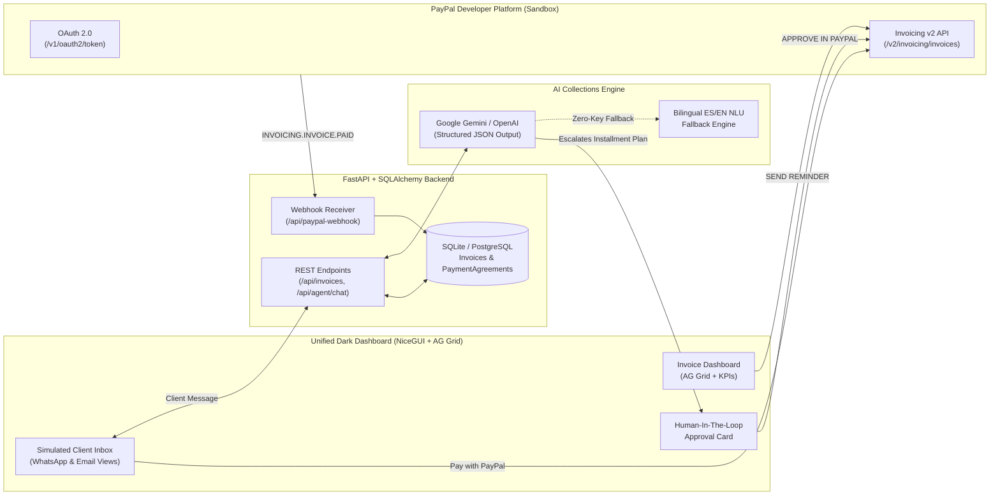

# 🤖 FacturaBot — Autonomous AI Accounts Receivable & Collections Agent for PayPal Invoicing

[](LICENSE)
[](https://developer.paypal.com/docs/api/invoicing/v2/)
[](#ai--agentic-commerce-architecture)
[](#sponsor-tools-integration)
[](#sponsor-tools-integration)
[](#sponsor-tools-integration)

> **Built for the [PayPal AI Hackathon: Build What's Next with PayPal and AI](https://paypalaihackathon.devpost.com/)**
> 🌐 **Live Hosted Demo (Render):** **[https://paypal-prueba.onrender.com](https://paypal-prueba.onrender.com)**
> *Category Alignment: Best Use of PayPal + AI • Best Use of Agentic Commerce • Best Use of AG Grid • Best Use of Render*

---

## 🌍 Overview & Problem Statement

Late B2B invoice payments lock up billions in working capital for small and medium businesses (SMBs). Traditional collections processes are either **manual and slow** (finance teams chasing clients over email/WhatsApp) or **rigid and confrontational** (automated dunning emails that demand 100% immediate payment, causing strained client relationships and defaults).

**FacturaBot** solves this by putting an **empathetic AI Collections Agent** in front of the **PayPal Invoicing v2 API**, governed by a **Human-In-The-Loop (HITL)** supervisor control panel:

1. **Proactive Outreach & Reminders:** Monitors overdue and pending invoices in real time and dispatches PayPal Invoicing reminders (`POST /v2/invoicing/invoices/{id}/remind`) alongside conversational WhatsApp/Email outreach.
2. **Autonomous Negotiation:** When a client explains cash-flow constraints (e.g., *"I don't have the full amount right now, can I pay in 2 parts?"*), FacturaBot calculates an installment plan and structures a formal credit proposal.
3. **Human-In-The-Loop (HITL) Governance:** Rather than letting an AI unilaterally alter credit terms, installment proposals surface in the supervisor's **Human-In-The-Loop** card. With a single click on **`APPROVE IN PAYPAL`**, FacturaBot configures the PayPal Invoice for partial payments (`allow_partial_payment: true`, `minimum_amount_due`) and delivers the updated PayPal checkout link to the client.
4. **Real-Time PayPal Reconciliation:** Processes payments directly via PayPal Invoicing v2 (`POST /v2/invoicing/invoices/{id}/payments`) and listens to live PayPal Webhooks (`INVOICING.INVOICE.PAID`, `INVOICING.INVOICE.CANCELLED`, `INVOICING.INVOICE.REFUNDED`) to update KPIs and invoice grids automatically.

---

## 🏗️ System Architecture



---

## 💳 How We Use PayPal Developer Platform

All PayPal API integrations live in [`InvoicingAPI.py`](InvoicingAPI.py) and [`app/services/invoice_service.py`](app/services/invoice_service.py), targeting the PayPal Sandbox environment (`https://api-m.sandbox.paypal.com`):

| Capability | PayPal Endpoint | Role in FacturaBot |
| :--- | :--- | :--- |
| **OAuth 2.0 Authentication** | `POST /v1/oauth2/token` | Exchanges `PAYPAL_CLIENT_ID` & `PAYPAL_CLIENT_SECRET` for a cached Bearer access token. |
| **Invoice Numbering** | `POST /v2/invoicing/generate-next-invoice-number` | Generates sequential PayPal invoice numbers for new receivables. |
| **Draft & Send Invoice** | `POST /v2/invoicing/invoices` & `/send` | Creates B2B invoices with item breakdowns and dispatches official PayPal payment links. |
| **Partial Payment Plans (HITL)** | `allow_partial_payment: true` + `minimum_amount_due` | Triggered when a human supervisor clicks **`APPROVE IN PAYPAL`**, enabling installment checkout on the PayPal invoice. |
| **Automated Reminders** | `POST /v2/invoicing/invoices/{id}/remind` | Triggered from the dashboard **`SEND REMINDER`** button. |
| **Payment Recording** | `POST /v2/invoicing/invoices/{id}/payments` | Records full or partial payments and reconciles the invoice ledger. |
| **Real-Time Webhooks** | `POST /api/paypal-webhook` | Handles `INVOICING.INVOICE.PAID`, `INVOICING.INVOICE.CANCELLED`, and `INVOICING.INVOICE.REFUNDED`. |

> **Hybrid Sandbox Resilience:** For effortless judging, if `PAYPAL_CLIENT_ID` and `PAYPAL_CLIENT_SECRET` are not set in `.env`, [`InvoicingAPI.py`](InvoicingAPI.py) automatically runs in **Hybrid Sandbox Simulation Mode**, executing the full end-to-end UX and database state transitions without throwing credential errors.

---

## 🧠 AI & Agentic Commerce Architecture

Implemented in [`app/services/agent_service.py`](app/services/agent_service.py):

- **Multi-Provider LLM Support:** Connects natively to **Google Gemini** (`gemini-2.5-flash` via `GEMINI_API_KEY`) or **OpenAI** (`gpt-4o-mini` via `OPENAI_API_KEY`) using strict JSON Structured Outputs (`intent`, `message`, `installments`, `trigger_hitl`, `mark_paid`, `show_paypal_btn`).
- **Deterministic Bilingual NLU Fallback:** If no external LLM API key is configured, FacturaBot falls back seamlessly to a built-in **English & Spanish NLU Engine** that extracts installment counts (`2` to `6` payments), detects promises to pay, answers balance inquiries, and triggers *Human-In-The-Loop* proposals with zero latency.
- **Live Language Switcher (`EN / ES`):** Click the **`EN / ES`** button in the top navigation bar to switch the entire UI and AI agent responses between **English** and **Spanish** in real time.

---

## 🏆 Sponsor Tools Integration

1. **AG Grid (`ui.aggrid`):**
   - Integrated in [`app/components/invoice_grid.py`](app/components/invoice_grid.py) using `ag-theme-quartz-dark` styled to match FacturaBot's dark slate palette (`#0E131D`).
   - Features column filtering (`Client`, `Invoice ID`, `Due Date`, `Status`), currency formatters, custom HTML status badge renderers, and interactive action buttons.
   - Click **`AG Grid: View`** in the top header to toggle between the custom compact table and the full interactive **AG Grid** experience.
2. **Render (`render.yaml`):**
   - Blueprint configuration in [`render.yaml`](render.yaml) for one-click cloud deployment with `/api/health` readiness probes and SQLite/PostgreSQL persistence.
3. **Postman (`postman/PayPal_Collection_Agent.postman_collection.json`):**
   - Complete Postman v2.1 collection covering FacturaBot's AI & REST endpoints, simulated PayPal Webhooks, and direct PayPal Sandbox Invoicing v2 requests.

---

## 🚀 Quick Start (Run Locally in < 2 Minutes)

### 1. Clone the repository & create a virtual environment
```bash
git clone https://github.com/R1ckyB/Paypal.git
cd Paypal
python3 -m venv .venv
source .venv/bin/activate  # On Windows: .venv\Scripts\activate
pip install -r requirements.txt
```

### 2. Configure environment variables (Optional for Demo, Required for Live PayPal Sandbox)
```bash
cp .env.example .env
```
Edit `.env` to add your PayPal Sandbox credentials (from [developer.paypal.com](https://developer.paypal.com/dashboard/applications)) and optional Gemini/OpenAI key:
```env
PAYPAL_CLIENT_ID=your_paypal_sandbox_client_id
PAYPAL_CLIENT_SECRET=your_paypal_sandbox_client_secret
PAYPAL_BASE_URL=https://api-m.sandbox.paypal.com
GEMINI_API_KEY=your_gemini_api_key
PORT=8080
```
*(Note: The app works out-of-the-box even without API keys thanks to the built-in Sandbox & NLU fallback mode!)*

### 3. Start FacturaBot
```bash
python main.py
```
Open **`http://localhost:8080`** in your browser.

---

## 🧪 How to Test the End-to-End Demo Flow

1. **Switch Language / Grid Mode:** Use the top-right header buttons **`EN / ES`** to switch between English and Spanish, and **`AG Grid: View`** to inspect the interactive AG Grid table.
2. **Approve a Human-In-The-Loop Proposal:**
   - Notice the pre-loaded proposal at the bottom left: *"AI Proposal: Approve 2-installment payment plan for Globex?"*
   - Click **`APPROVE IN PAYPAL`** (`APROBAR EN PAYPAL`).
   - Watch Globex's status change from `Overdue` to `Partial Plan`, the KPI cards recalculate, and FacturaBot send the approved installment plan with a **`[ Pay with PayPal ]`** button to the Client Inbox on the right.
3. **Negotiate a New Payment Plan via AI Chat:**
   - Click on **Stark Industries** (`$22,000.00`, `Overdue`) in the invoice table.
   - In the Client Inbox input (bottom right), type:
     - English: `"We cannot pay the full amount today, can we split it into 3 payments?"`
     - Spanish: `"No cuento con el total hoy, ¿podemos dividirlo en 3 pagos?"`
   - FacturaBot's AI Agent will calculate 3 installments of `$7,333.33 USD` and trigger a new **Human-In-The-Loop** alert on the dashboard for supervisor approval.
4. **Complete a PayPal Payment:**
   - Click the **`[ Pay with PayPal ]`** (`[ Pagar con PayPal ]`) button inside any chat bubble (or toggle **`Email / WhatsApp View`** to pay from the formal PayPal Invoice email template).
   - The payment is recorded via `InvoicingAPI.record_invoice_payment`, the invoice badge updates to `Paid`, and the **Recovered** KPI increases in real time.

---

## 🔌 REST API Endpoints & Postman Collection

Import [`postman/PayPal_Collection_Agent.postman_collection.json`](postman/PayPal_Collection_Agent.postman_collection.json) into Postman to test all backend routes directly:

- `GET /api/health` — Returns service health, PayPal Sandbox status, and active AI engine.
- `GET /api/invoices` — Lists all invoices stored in SQLite/PostgreSQL.
- `POST /api/agent/chat` — Sends a client message to FacturaBot AI and returns structured negotiation output + HITL proposals.
- `POST /api/invoices/{invoice_id}/remind` — Dispatches a PayPal Invoicing v2 reminder (`/remind`).
- `POST /api/invoices/{invoice_id}/approve-plan` — Approves a partial payment plan in PayPal Invoicing v2 (`allow_partial_payment: true`).
- `POST /api/invoices/{invoice_id}/pay` — Records an invoice payment in PayPal Invoicing v2 (`/payments`).
- `POST /api/paypal-webhook` — Processes asynchronous PayPal webhook events (`INVOICING.INVOICE.PAID`, `CANCELLED`, `REFUNDED`).

---

## 🇪🇸 Resumen en Español

**FacturaBot** es un agente autónomo de cobranza B2B impulsado por IA y construido sobre **PayPal Invoicing v2 API**.
- **Problema que resuelve:** Automatiza el seguimiento y negociación de facturas vencidas por WhatsApp y correo electrónico sin perder el control financiero gracias a su flujo **Human-In-The-Loop (HITL)**.
- **Tecnologías:** Python, FastAPI, NiceGUI, AG Grid, SQLAlchemy (SQLite/PostgreSQL), PayPal Invoicing v2 API + Webhooks, y Google Gemini / OpenAI con motor NLU bilingüe integrado.
- **Licencia:** Distribuido bajo la licencia Open Source [MIT](LICENSE).
